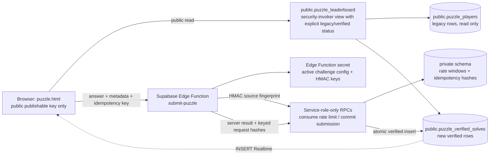

# CyberX M6 — Puzzle Validation Architecture

**Status:** Local implementation prepared; no migration or Edge Function is deployed.  
**Scope:** The current single puzzle route and its Hall of Fame. The browser remains anonymous; display names are not authenticated identities.

## Existing flow and changes

Before M6, `puzzle.html` compared the trimmed, case-sensitive answer against a JavaScript constant, then inserted `{name, domain}` directly into `public.puzzle_players`. The answer therefore shipped to every browser, and a caller could bypass the UI and insert a fabricated Hall of Fame record through the public Data API. A client-side name lookup was only a convenience check; the existing database unique index arbitrated duplicate names.

The page now sends the trimmed answer, `challenge_id`, trimmed display name, optional domain, and a random idempotency key to `submit-puzzle`. It does not decide correctness or write either leaderboard table. The answer remains case-sensitive after trimming, matching the previous input behavior. The expected value is supplied only through a server-side Edge Function secret; it is not in the HTML, JavaScript, migration, tests, or public responses.

## Implemented flow

1. Browser loads the public `puzzle_leaderboard` view with an explicit field projection. The view labels existing `puzzle_players` rows `legacy_unverified` and new rows `server_verified`.
2. Browser sends a bounded JSON request to the `submit-puzzle` Edge Function. It includes no correctness, score, rank, timestamp, identity, or IP assertion.
3. Function enforces method, content type, body size, fields, origin, project publishable key, and source-header format. It consumes a database-backed source rate limit before checking challenge existence.
4. Function loads the active challenge value from `CYBERX_CHALLENGE_CONFIG_JSON`, computes keyed HMACs for the candidate and configured answer, and compares fixed-length digests. Answers and keys are not logged or sent to SQL.
5. Function calls the service-role-only `commit_puzzle_submission` RPC with a Boolean produced by server verification, plus keyed request/idempotency hashes and display metadata.
6. The database transaction replays matching idempotency requests, rejects conflicting key reuse, records incorrect outcomes without a solve, and atomically creates a server-timestamped verified solve for a correct answer. A per-challenge normalized-name unique constraint handles concurrent duplicate names.
7. Only after HTTP 201 with a valid server-generated solve ID and timestamp does the browser show success. Network/5xx/malformed responses remain retryable with the same in-memory idempotency key.

## Architecture

The public read model contains only `id`, `name`, `domain`, `created_at`, and a verification label. The private schema contains no answer, raw IP, display name, or submitted answer. Challenge answers and keyed HMAC secrets are environment secrets, not database rows.

## Trust boundaries and identity

The function is a public anonymous endpoint. The browser publishable key identifies the CyberX application component, not a person. The `verify_jwt` check is disabled **only for this function** because this flow has no user JWT and uses a publishable key; the handler checks that the `apikey` matches the configured publishable key. This is not authentication, authorization of a user, or a CORS security boundary. Supabase documents the distinction between API keys and user identity in its [API key guide](https://supabase.com/docs/guides/getting-started/api-keys) and its [Edge Function authorization header guide](https://supabase.com/docs/guides/functions/auth-headers).

A participant can choose another display name. The database guarantees only one normalized name per challenge, not one solve per human. Strong person-level uniqueness requires an account or another verified identity mechanism and is not introduced in M6.

## Failure behavior

- Invalid request: safe 400/413/415/401 response; no solve.
- Unknown and inactive challenge IDs: same generic 404 body after rate-limit accounting.
- Incorrect answer: generic incorrect response; no verified row.
- Rate limit: 429 and bounded `Retry-After`; no internal counter is returned.
- Database/configuration/network failure: generic retryable 503; no client-side success fallback.
- Duplicate normalized display name: 409; it is not presented as a new successful solve.
- Repeated matching request: same safe verified result; no second row.

## Historical records

The old `puzzle_players` table is preserved and remains publicly readable under its current SELECT policy. New anonymous INSERT/UPDATE/DELETE/TRUNCATE access is revoked by the M6 migration. Existing rows are labeled `LEGACY · UNVERIFIED`; they are not upgraded or deleted. The M5 aggregate precheck and metadata row summary disagreed, so this implementation does not rely on a historical count.

## Deployment gates

The connected project is treated as production. The current project inspection found no deployed Edge Functions and no recorded migrations. The M5 and M6 migrations, Edge Function source, and frontend changes are local only. Before an owner-approved release: verify API exposed-schema settings and migration history, stage M5 then M6 on a disposable Supabase project, install the challenge and HMAC secrets through the secret manager, set the exact production origin, run the SQL and live function tests, then schedule separate production approvals. No production deployment or security verification is claimed.