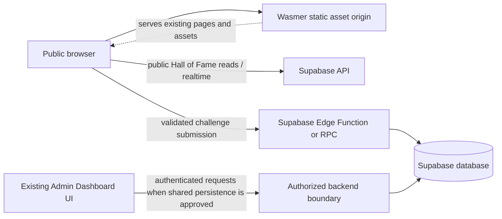

# CyberX target architecture

Status: proposed architecture for review; no implementation changes made. The design keeps the current static-site strengths and all existing user-visible features while moving trust and persistence decisions to enforceable boundaries. The Admin Dashboard remains the existing product surface and is not rebuilt.

## Target shape

1. **Static presentation**: continue serving the home, awareness, puzzle, and current admin experiences as static pages. Preserve URLs, content, responsive behavior, and CyberX palette/typography. Gradually extract reusable CSS, shared page-shell elements, and modules into reviewed assets without an unrequested framework rewrite.
2. **Public Supabase client**: keep only the Supabase project URL and publishable/anon key in browser code. Treat both as public. Never place database passwords, service-role/secret keys, privileged tokens, or admin credentials in HTML, JavaScript, Git history, or static deployment variables exposed to the browser.
3. **Database controls**: use reviewed migrations and least-privilege grants/RLS. The Hall of Fame may expose only fields intended for public display. Enforce normalized-name uniqueness and input constraints in the database. A server-side function/RPC should validate challenge completion using a non-public secret or signed proof if the product requires meaningful anti-spoofing; a static page cannot keep a flag secret. Define privacy/retention for names and domains before collection.
4. **Admin boundary**: retain the current dashboard UI and all workflows. For any future shared/server-persisted admin data, put authentication and authorization on a backend boundary and require an authenticated admin identity/role for every write. Do not treat the existing password gate or browser storage as security. Decide whether local-only behavior remains a supported offline/demo mode or is migrated after a data/export plan.
5. **Experience form**: preserve the form and feed experience while adding server-side validation, safe text rendering, moderation/abuse controls, and durable storage only after its privacy and moderation policy is agreed.
6. **Static deployment**: serve the repository's static assets using Wasmer Edge's static web server. Use a deliberate publish directory containing the approved public files. Prevent deployment of source notes, Git metadata, credentials, and unreviewed files. Configure headers and clean routes only after verifying platform behavior and compatibility with Supabase.

## Proposed logical diagram

The admin backend path is a target for a later approved phase, not an assumption that current localStorage data should immediately be migrated. Production Supabase must not be changed as part of this audit or without a separately reviewed migration and explicit authorization.

## Data contracts to define before implementation

- `puzzle_players`: stable ID, normalized unique operator name, optional domain or safer display label, server-generated creation time; no privileged or unnecessary personal data. Document who can select/insert, field visibility, RLS, retention, and Realtime publication.
- Admin media and puzzle records: schema, IDs, validation rules, export/import compatibility, ownership/role model, and deletion/backup policy. Preserve current export formats or provide a migration adapter.
- Experience submissions: validation, moderation state, retention, spam controls, consent/privacy notice, and safe rendering contract.

## Non-functional requirements

- Preserve current page routes, content, key interactions, colors, typography, and responsive behavior.
- Every public write is bounded, validated, rate-limited where supported, and safe under hostile input.
- No secret is delivered to the browser; least privilege and RLS are verified in a non-production environment.
- Admin authorization is server-enforced; local browser storage is explicitly labeled as local-only if retained.
- Build/deploy output is reproducible, minimal, and excludes notes, credentials, and repository metadata.
- Accessibility, browser behavior, and feature regressions are checked before release.
